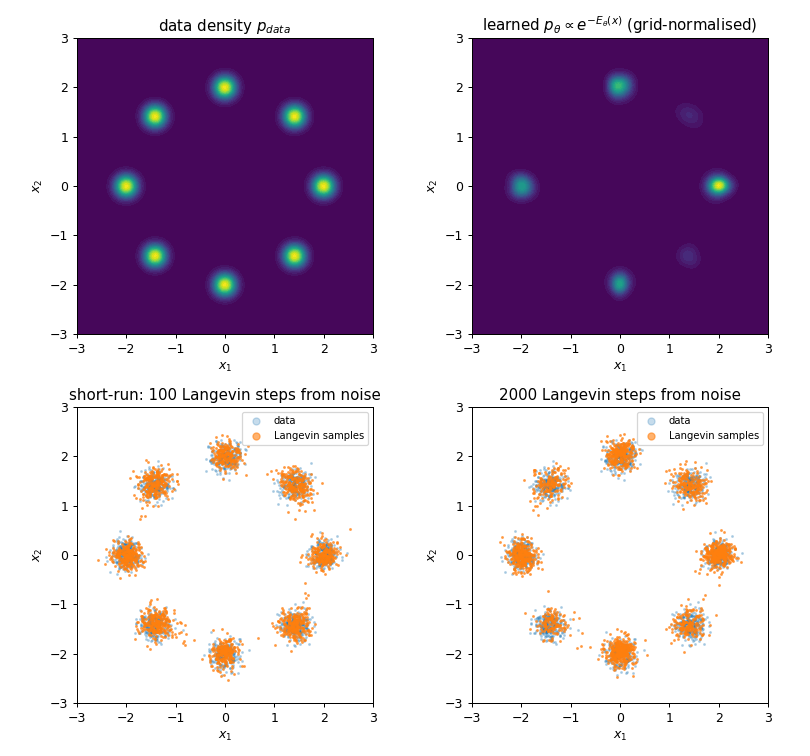
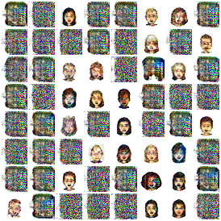
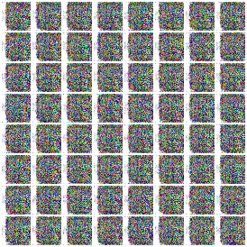
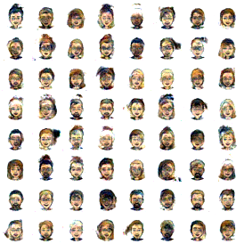
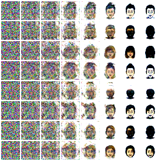
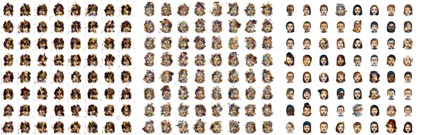
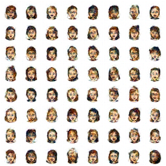
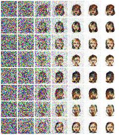

# Energy-Based Models

Tutorial code for energy-based models (EBMs): $p_\theta(x) = e^{-E_\theta(x)} / Z_\theta$ with a neural network energy $E_\theta$, trained by maximum likelihood with Langevin samples. Each version adds one idea: short-run Langevin on a 2-D toy (version0), persistent chains in a replay buffer (version1), an image EBM on Bitmoji faces that turns noise into faces in 100 steps and also inpaints and denoises (version2), conditional super-resolution $E_\theta(x_{hr}\mid x_{lr})$ (version3), and diffusion recovery likelihood, a chain of conditional EBMs over noise levels (version4).

---

## Theory

Please note that the theory corresponding to the codes is hosted on this [page](https://parag1604.github.io/notes/Machine-Learning/Energy-Based-Models). The notation below follows it: energy $E_\theta$, temperature $\tau$, Langevin step size $\eta$, and the score $\nabla_x \log p_\theta(x) = -\nabla_x E_\theta(x)$.

## Python Environment Setup

Use python >= 3.10 and install the requirements:

```bash
pip install -r requirements.txt
```

- PyTorch: models, automatic differentiation and training (install the hardware-accelerated build if possible; the image scripts pick CUDA, then Apple MPS, then CPU)
- Torchvision: saving image grids
- NumPy and Pillow: loading and caching the images
- Matplotlib: the toy plots

## Data

`version0.py` and `version1.py --data toy` need no data: they sample a mixture of 8 Gaussians on a circle on the fly.

The image versions use **Bitmoji faces**: 130,227 cartoon avatar heads, 128x128 RGB PNGs on a white background (about 1.4 GB). The copy used here was downloaded from the internet; we could not pin down the exact original page, so get it from a public Bitmoji dataset (e.g. Kaggle). The scripts expect a **flat folder of image files**:

```
data/bitmojis/
    199700001-10212369-0.png
    199700002-10212369-0.png
    ...
```

(File names in our copy have the form `<number>-10212369-0.png`; any names work.) On first use the scripts read the folder once, resize to the working resolution and cache the result as `data/bitmojis_<size>.npy` (0.4 GB at 32x32, 1.6 GB at 64x64). The last 2,000 files in name order are held out as a test set. Neither the data nor the cache is committed to this repository.

## The common pieces

Every script uses the same three ingredients (`utils.py`).

**The likelihood gradient** (lecture eq. 9). $Z_\theta$ is intractable, but its gradient is an expectation under the model, so

$$\nabla_\theta\,\mathrm{NLL} = \mathbb{E}_{x\sim p_{data}}[\nabla_\theta E_\theta(x)] - \mathbb{E}_{x'\sim p_\theta}[\nabla_\theta E_\theta(x')].$$

Energy goes down on data and up on the model's own samples. With $x'$ drawn by a few MCMC steps and treated as constants, this is the contrastive-divergence idea (Hinton 2002). The loss we minimise is

$$L = \overline{E_\theta(x)} - \overline{E_\theta(x')} + \alpha\,\overline{E_\theta(x)^2 + E_\theta(x')^2},$$

where the bars are batch means and the $\alpha$ term keeps the energies near zero (Du & Mordatch 2019).

**Langevin dynamics** (lecture eq. 10), at temperature $\tau$:

$$x_{k+1} = x_k - \tfrac{\eta}{2}\nabla_x E_\theta(x_k) + \sqrt{\eta\tau}\,\epsilon_k,\qquad \epsilon_k\sim\mathcal N(0, I).$$

It needs only the score, so $Z_\theta$ never appears (Welling & Teh 2011 use the same update for Bayesian posteriors). The code writes it as `x - step_size * grad + noise_std * eps`, i.e. `step_size` $=\eta/2$ and `noise_std` $=\sqrt{\eta\tau}$. The toys use the exact sampler, $\tau = 1$. The image models follow common practice and use far less noise than that (e.g. `step_size = 10`, `noise_std = 0.005` in version2, which is $\tau\approx 10^{-6}$), and clip each gradient entry: their chains are noisy optimisers rather than exact samplers. version4 returns to the exact sampler, $\tau=1$, because its conditional energies are easy to sample.

**Short-run vs persistent chains.** Short-run chains start from noise at every iteration (Nijkamp et al. 2019); persistent chains continue where earlier chains stopped, from a replay buffer (Tieleman 2008; Du & Mordatch 2019).

## Running

### 0. Short-run Langevin on a 2-D toy

```bash
python version0.py
```

The energy $E_\theta:\mathbb{R}^2\to\mathbb{R}$ is a small MLP with SiLU (Swish) activations, which keep the landscape and its gradient smooth. The data are 8 Gaussians on a circle. Every iteration starts 256 fresh chains from uniform noise, runs $K=100$ exact Langevin steps ($\eta=0.005$, $\tau=1$), and takes one Adam step on $L$ with $\alpha=0.01$. After 3,000 iterations (2.5 to 3.5 min on an Apple-silicon CPU) the script draws 2,000 new chains and writes `results/version0_toy.png`:



| | samples within 0.5 of a mode | share of the smallest / largest mode (ideal 0.125) |
|---|---|---|
| short-run samples, $K=100$ (as in training) | 97.9% | 0.111 / 0.139 |
| long-run samples, 2,000 steps | 98.4% | 0.068 / 0.180 |
| the learned density $e^{-E_\theta}$ itself (normalised on the plotting grid) | | 0.003 / 0.286 (total variation from uniform: 0.39) |

The lesson of Nijkamp et al. (2019): a model trained with short-run chains from noise becomes an excellent **$K$-step sampler**, but $e^{-E_\theta}$ is **not** a faithful density. Its wells have very different depths, and chains run for longer than $K$ steps drift toward the deep ones.

### 1. Persistent chains: a replay buffer

```bash
python version1.py --data toy
python version1.py --data bitmoji --data-dir /path/to/bitmojis --iters 4000
```

The one new idea is the **replay buffer** (persistent contrastive divergence; Tieleman 2008, Du & Mordatch 2019). The buffer holds 10,000 chain states. Each iteration takes a batch from it, restarts 5% of them from noise, runs $K$ Langevin steps and writes the results back. A chain that is picked many times has run for hundreds or thousands of steps, so the negatives approach samples of $p_\theta$ itself, not of a $K$-step sampler. Two stabilisers come with it: parameter-gradient norm clipping (max norm 1) and a cosine learning-rate decay on the toy; `--spectral-norm` adds spectral normalisation (off by default).

**Toy** ($K=40$, 3,000 iterations, about 1 min on a CPU; `results/version1_toy.png`):


| | samples within 0.5 of a mode | smallest / largest mode share |
|---|---|---|
| 40 steps from noise | 82.5% | 0.095 / 0.153 |
| 2,000 steps from noise | 94.6% | 0.105 / 0.162 |
| learned density $e^{-E_\theta}$ | | 0.042 / 0.192 (total variation from uniform: 0.17) |

Now the trade-off is reversed: the energy is a better density (total variation 0.17 against 0.39 for version0; one seed each), and long chains sample it well, but it is a worse 40-step sampler from noise, because it was never trained to be one. There is also a faint spurious ridge between two modes in the top-right panel.

**Images** (32x32 Bitmojis, a small ConvNet energy of width 32, $K=60$, `step_size` 10, gradient entries clipped to $\pm0.03$, `noise_std` 0.005, $\alpha=0.1$, batch 128, Adam lr $10^{-4}$, 4,000 iterations: 77 min on an NVIDIA GB10 that was shared with other jobs):





Honest result: this small model only half works. About a quarter of the buffer has become recognisable faces (the long-lived chains), but most buffer states and all fresh 240-step chains from noise (second grid) are still coloured noise. version2 finds the two culprits: the network's global average pooling, and the persistent chains themselves.

### 2. An image EBM that samples from noise, and using its energy

```bash
python version2.py --data-dir /path/to/bitmojis          # trains, saves checkpoints/version2_iter<N>.pt every 1,000 iterations
python version2.py --data-dir /path/to/bitmojis --eval-only --checkpoint checkpoints/version2.pt
python version2.py --data-dir /path/to/bitmojis --pooled            # ablation: version1's network
python version2.py --data-dir /path/to/bitmojis --buffer --steps 60 # ablation: version1's replay buffer
```

version1's image model failed for two reasons, and version2 fixes both.

1. **A position-aware energy** (`models.ImageEnergy`, laid out like a DCGAN discriminator). version1's network ends in global average pooling, so its energy cannot easily tell *where* a feature is (eyes above a mouth, hair on top). The new network is a 3x3 conv followed by three stride-2 4x4 convs (width 64, 128, 256, 512) and a final layer that is fully connected over the remaining 4x4 map, so every position has its own weights. SiLU activations, no normalisation layers, 2.8 M parameters.
2. **Short-run chains from noise** (version0's recipe, Nijkamp et al. 2019). For images we want a *sampler*: something that turns noise into a face. So, as in version0, every iteration starts 128 fresh chains from uniform noise and runs $K=100$ Langevin steps (`step_size` 10, gradient entries clipped to $\pm0.01$, `noise_std` 0.005); there is no buffer.

The rest: $\alpha=0.1$, batch 128, Adam with lr $10^{-4}$ and $\beta_1=0.5$, training images jittered with noise of std 0.005, bfloat16 autocast (twice as fast). We trained for 50 min, about 3,200 iterations, on an NVIDIA GB10 that was running two of our other jobs at the same time. Training was stable: the collapse detector (the ratio of pixel-to-pixel variation in the negatives to that in real images, 1 = healthy) stayed between 0.97 and 1.31 from iteration 250 to the end.

64 fresh chains from uniform noise, 100 steps each (exactly the sampler used in training):



Almost all are recognisable Bitmoji faces, with varied hair, skin tones, glasses and beards; they are grainy and some are blotchy. The evolution of 8 chains (columns: noise, then 10, 20, 40, 60, 100, 200 and 400 steps) shows the faces appear between steps 40 and 100, and what happens when a chain runs on **past** the $K=100$ steps it was trained for:



By 200 to 400 steps the faces turn into flat, saturated silhouettes. This is version0's lesson on images: a short-run model is a good **$K$-step sampler**, but $e^{-E_\theta}$ is not a faithful density, and longer chains slide into its deepest (here: high-contrast) wells (Nijkamp et al. 2019).

**Which fix matters?** Both. We trained each ablation for 15 min with the other settings unchanged (in parallel with other jobs, so fewer iterations), and compare with the main run's iteration-1,000 checkpoint. "Fréchet distance" is a crude FID-like score computed on the top 64 principal components of the pixels (`utils.pca_frechet`; lower is better; 2,000 real training faces score 2.4 against the held-out faces):

| variant | iterations | samples from noise | Fréchet distance |
|---|---|---|---|
| version2 (position-aware, short-run) | 1,000 | faces | 71.2 |
| version2 (position-aware, short-run) | 3,200 | faces (grid above) | 108.8 |
| `--pooled` (version1's network, short-run) | 556 | noisy face-shaped blobs | 393.0 |
| `--buffer --steps 60` (position-aware, replay buffer) | 1,440 | coloured noise | 292.7 |

The Fréchet distance does **not** keep improving with training: 71.2, 85.5 and 122.6 at iterations 1,000, 2,000 and 3,000, and 108.8 at the end. By eye, the later samples are more varied (more glasses, beards and dark hair; the iteration-1,000 samples are mostly brown-haired) but grainier, and this crude score prefers the smoother, more average faces. Treat it as a coarse check, not a ranking.



*Left: the pooled network with short-run chains. Middle and right: the position-aware network with a replay buffer; fresh 60-step chains from noise (middle) never become faces, but the buffer's own long-lived chains (right) are the crispest unconditional samples in this repository.* So the pooled network is why version1's buffer held only a quarter faces, and the buffer is why its fresh chains stayed noise: a buffer model gives excellent samples **only** through its long-lived chains, as in version1's toy. version2 keeps the short-run recipe because it samples from scratch, and is stable without the collapse of our earlier buffer runs.

An earlier version of this script used the pooled network with the replay buffer. Its first run looked good after 1,250 iterations and then collapsed: by 4,441 iterations almost the whole buffer was saturated coloured noise, which the energy had come to treat as likely. That is why the collapse detector is still logged:

: collapsed buffer")

**Using the energy as a prior.** An energy can be reused **without retraining**:
- **inpainting:** keep the observed pixels fixed and run 100 Langevin steps on the missing ones only, starting from uniform noise (as in training);
- **denoising:** start from the noisy image and run 20 noise-free steps downhill on $E_\theta$.

Restoration on the 2,000 held-out faces (PSNR on the whole image):

| task | baseline | version2 | version2 at iteration 1,000 | `--buffer` ablation |
|---|---|---|---|---|
| denoising, Gaussian noise $\sigma=0.2$ | noisy input 21.86 dB | 24.06 dB | 23.63 dB | **25.27 dB** |
| inpainting, lower half missing | average-face fill **18.67 dB** | 16.83 dB | 16.40 dB | 13.41 dB |

")

")

Denoising works (+2.2 dB), and the buffer-trained energy is the better denoiser (+3.4 dB): again, persistent chains give the better density, short-run chains the better sampler. Inpainting fills the lower half with sharp, plausible chins, mouths and shirts, but they are the model's own guess (a sample), so the PSNR is below the blurry average-face fill: PSNR rewards averages, not plausible guesses. version3 makes this precise.

### 3. Conditional super-resolution, $E_\theta(x_{hr}\mid x_{lr})$

```bash
python version3.py --data-dir /path/to/bitmojis                    # conditional (default)
python version3.py --data-dir /path/to/bitmojis --unconditional    # Parag's original formulation
```

**Credit.** The idea and the first implementation are Parag's (the original course code, `main_SR.py`): super-resolve a face by running Langevin descent on an energy, starting from the blurry upsampled image. In that code the energy scored the high-resolution image alone, $E_\theta(x_{hr})$, so the low-resolution input only chose where the chain started.

**What version3 adds.** The energy is now **conditional**,

$$p_\theta(x_{hr}\mid x_{lr}) = \frac{e^{-E_\theta(x_{hr},\,x_{lr})}}{Z_\theta(x_{lr})},$$

with the bicubic-upsampled $U(x_{lr})$ stacked with $x_{hr}$ as a 6-channel input to version2's position-aware network. Training is eq. 9 with every expectation conditioned on $x_{lr}$; the negatives come from $K=40$ short-run Langevin steps started at $U(x_{lr}) + 0.1\,\epsilon$. The starting noise matters: different starts end in different, equally plausible faces, so the chain is a **sampler** of $p_\theta(x_{hr}\mid x_{lr})$, and at test time the same chain is the super-resolver. Because the degradation $D$ (antialiased bicubic downsampling) is known, it also gives a likelihood, so we can add a data-consistency energy at test time (posterior = likelihood x prior):

$$E_{total}(x) = E_\theta(x\mid x_{lr}) + \tfrac{\lambda}{2}\lVert D(x) - x_{lr}\rVert^2.$$

**Setup.** 64x64 faces from 16x16 inputs (4x), network width 64 (2.9 M parameters), batch 64, Adam lr $10^{-4}$, `step_size` 5 with gradient entries clipped to $\pm0.01$, `noise_std` 0.005, $\alpha=0.1$. Each model trained for 4,595 iterations (41 to 45 min on the GB10, which was running one or two of our other jobs at the same time; `--iters 4595`). Evaluation on the 2,000 held-out faces; PSNR is on the $[-1,1]$ scale, "consistency" is PSNR($D(\hat x)$, $x_{lr}$), and "sharpness" is the mean absolute difference between neighbouring pixels.

| method | PSNR vs ground truth | consistency | sharpness |
|---|---|---|---|
| bicubic | 18.79 dB | 30.93 dB | 0.047 |
| consistency term alone, no EBM (40 steps of gradient descent on $\tfrac{\lambda}{2}\lVert D(x)-x_{lr}\rVert^2$ from the bicubic image) | 20.04 dB | 50.52 dB | 0.058 |
| **EBM sample** (noisy start, Langevin noise) | 21.93 dB | 38.52 dB | 0.110 |
| **EBM, mean of 8 samples** | 24.66 dB | 41.27 dB | 0.088 |
| **EBM, deterministic chain** (start at the bicubic image, no noise) | **25.01 dB** | 40.88 dB | 0.089 |
| EBM deterministic + consistency, $\lambda=2$ | 24.60 dB | 49.63 dB | 0.095 |
| unconditional EBM (the original formulation), deterministic chain | 24.08 dB | 36.39 dB | 0.090 |
| unconditional EBM, mean of 8 samples | 23.92 dB | 36.98 dB | 0.091 |
| ground truth | | exact | 0.094 |


*Rows: bicubic | EBM sample | another sample | EBM deterministic chain | ground truth.* The unconditional model's grid is in `static/version3_uncond_sr.png`.

What we learn:
- **The EBM now clearly beats bicubic**: +6.2 dB PSNR for the deterministic chain, with outputs about as sharp as the real faces (0.089 against 0.094), and +5.0 dB over the consistency term alone (classic back-projection). The previous version of this script was 0.16 dB *below* bicubic; it used the pooled network, 20 steps and no starting noise (we changed all three and did not ablate them separately). An earlier 45-min run of the current script under heavier GPU sharing reached only 2,973 iterations and 23.33 dB, so longer training still helps.
- **Conditioning helps**: at the same number of iterations, Parag's unconditional energy (which sees only $x_{hr}$; $x_{lr}$ only chooses the start) gets 24.08 dB and fits the input less well (36.4 against 40.9 dB consistency). The unconditional chain does surprisingly well because a short chain from the bicubic image stays close to it.
- **A sample is not the best guess.** A 16x16 input leaves several plausible faces (rows 2 and 3 differ in glasses, hair strands, shirt). One sample scores +3.1 dB: PSNR punishes a sharp guess that is slightly wrong more than a blur. The posterior **mean** minimises the expected squared error, and averaging 8 samples gets +5.9 dB; the deterministic chain, a mode-seeking descent, is about as good. This is the perception-distortion trade-off (Blau & Michaeli 2018) in one table: pick a sample for realism, the mean (or the deterministic chain) for PSNR.
- **The consistency term no longer adds PSNR.** It raises consistency (40.9 to 49.6 dB) but costs 0.4 dB here. Larger weights hurt more: with an earlier, less trained model, $\lambda=2$ was neutral while $\lambda=5$ and $10$ lost 0.9 and 2.4 dB, because the clipped gradient is then dominated by a term that knows nothing about faces. (We tried these few values on the held-out faces.) With a weak prior, as in the previous version of this script, the known degradation was the main source of gain; with a good prior, it is a small correction.

### 4. Diffusion recovery likelihood: one easy EBM per noise level

```bash
python version4.py --data-dir /path/to/bitmojis
```

version2's sampler has to travel from uniform noise to a face in one short chain, and its energy is only good for that one chain length. Gao et al. (2021) split the journey into $T$ short legs. Corrupt a face step by step, $x_{t+1} = \sqrt{1-\sigma_{t+1}^2}\,x_t + \sigma_{t+1}\epsilon$, and learn to undo **one** step at a time. With $y_t = \sqrt{1-\sigma_{t+1}^2}\,x_t$, the less noisy image given the noisier one has the conditional ("recovery") density

$$p_\theta(y_t\mid x_{t+1}) \propto \exp\!\Big(-E_\theta(y_t, t) - \frac{\lVert x_{t+1} - y_t\rVert^2}{2\sigma_{t+1}^2}\Big).$$

The Gaussian term is known exactly; only $E_\theta$ is learned. Because it keeps $y_t$ within about $\sigma_{t+1}$ of $x_{t+1}$, each conditional is close to unimodal, so a short Langevin chain at the **exact** temperature $\tau=1$ can sample it. Training is eq. 9 again, for the conditional at a random level: energy down on the true $y_t$, up on a $K=30$-step Langevin sample started at $x_{t+1}$. Generation starts from Gaussian noise and runs the $T$ chains in turn, $x_T\to x_{T-1}\to\dots\to x_0$. This is the bridge from EBMs to diffusion models: the noise levels are a diffusion's, but each reverse step is an EBM sampled by Langevin dynamics.

**Our setup.** $T=6$ levels with the signal-to-noise ratio log-spaced from $10^2$ to $10^{-2}$ ($\sigma_t$ = 0.10, 0.22, 0.49, 0.78, 0.89, 0.91); one network for all levels (version2's position-aware ConvNet plus a learned per-level bias in every layer); $E_\theta(y,t) = f_\theta(y,t)/s_t^2$ with Langevin step $s_t = 0.2\,\sigma_{t+1}$, so the gradient step has the same size at every level; the last level's chain runs without noise; batch 128, Adam lr $10^{-4}$, $\beta_1=0.5$; parameter-gradient norm clipping at 1, but no energy regulariser and no clipping of the Langevin gradient. The learning rate decays to 0 over 8,000 iterations (cosine); we trained for 35 min on the GB10 (shared with one other job for the first 25 min).

64 samples from Gaussian noise ($6\times30 = 180$ Langevin steps in all, about a second on the GPU):



and 8 chains, one column per level, $x_6$ (noise), $x_5, \dots, x_0$ (shown clipped to the image range):



| model | iterations | Fréchet distance (lower is better; real faces 2.4) | roughness, samples / data |
|---|---|---|---|
| version2, short-run from uniform noise | 3,200 | 108.8 | 1.03 |
| version4, diffusion recovery likelihood | 8,000 | **70.7** | 1.10 |

What we learn:
- The faces are smoother and cleaner than version2's (no blotches), and the Fréchet distance is lower (70.7 against 108.8). But they are **less varied**: mostly brown hair, few glasses or beards. With $T=6$ the first two chains have to turn almost pure noise into a rough layout, and that is where variety is decided. Our network and 35-min budget are small for this method; more levels, a wider network and longer training are the obvious next things to try.
- **Stability needs care.** Our first run used a constant learning rate: it trained well for 9,250 iterations and then blew up within 250 iterations (energy gaps of order $10^9$ to $10^{12}$). The script now decays the learning rate and stops (keeping the checkpoint saved every 2,000 iterations) if the loss explodes. The usual EBM fix, the energy regulariser $\alpha\,\overline{f^2}$, is **wrong here**: $f$ sets the size of the Langevin drift, so shrinking it stalls the chains (with $\alpha=0.01$ the negatives stopped moving and $f(\text{pos})-f(\text{neg})$ sat at $-3$ to $-6$ instead of near 0; we stopped that run after 1,000 iterations).
- The Fréchet distance is crude (see version2) and rewards average-looking faces, so it does not capture the loss of variety; look at the grids too.

## References

1. G. E. Hinton (2002). *Training Products of Experts by Minimizing Contrastive Divergence*. Neural Computation 14(8), 1771-1800. [doi:10.1162/089976602760128018](https://doi.org/10.1162/089976602760128018)
2. T. Tieleman (2008). *Training Restricted Boltzmann Machines using Approximations to the Likelihood Gradient*. ICML 2008. [doi:10.1145/1390156.1390290](https://doi.org/10.1145/1390156.1390290)
3. M. Welling and Y. W. Teh (2011). *Bayesian Learning via Stochastic Gradient Langevin Dynamics*. ICML 2011. [pdf](https://www.stats.ox.ac.uk/~teh/research/compstats/WelTeh2011a.pdf)
4. Y. Du and I. Mordatch (2019). *Implicit Generation and Modeling with Energy-Based Models*. NeurIPS 2019. [arXiv:1903.08689](https://arxiv.org/abs/1903.08689)
5. E. Nijkamp, M. Hill, S.-C. Zhu and Y. N. Wu (2019). *Learning Non-Convergent Non-Persistent Short-Run MCMC Toward Energy-Based Model*. NeurIPS 2019. [arXiv:1904.09770](https://arxiv.org/abs/1904.09770)
6. Y. Blau and T. Michaeli (2018). *The Perception-Distortion Tradeoff*. CVPR 2018. [arXiv:1711.06077](https://arxiv.org/abs/1711.06077)
7. P. Lippe. *Tutorial 8: Deep Energy-Based Generative Models*, UvA Deep Learning Tutorials (the image sampler settings follow it). [link](https://uvadlc-notebooks.readthedocs.io/en/latest/tutorial_notebooks/tutorial8/Deep_Energy_Models.html)
8. R. Gao, Y. Song, B. Poole, Y. N. Wu and D. P. Kingma (2021). *Learning Energy-Based Models by Diffusion Recovery Likelihood*. ICLR 2021. [arXiv:2012.08125](https://arxiv.org/abs/2012.08125)
