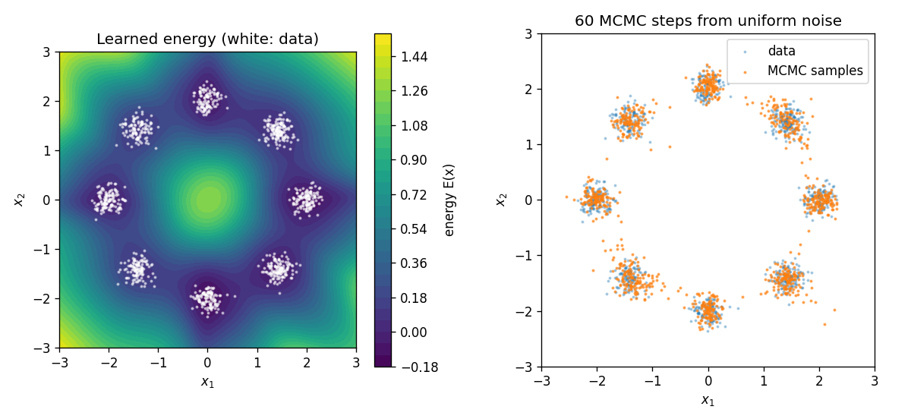

# Energy-Based Models

Code for Energy-Based Models (EBMs) trained with short-run MCMC: first on a 2-D toy distribution, then for super-resolution of Bitmoji faces.

---

## Theory

Please note that the theory corresponding to the codes is hosted on this [page](https://parag1604.github.io/notes/Machine-Learning/Energy-Based-Models)

## Python Environment Setup

Use python >= 3.10 and install the requirements:

```bash
pip install -r requirements.txt
```

- PyTorch - models, automatic differentiation and training (install the hardware accelerated build if possible; version1 picks CUDA, then Apple MPS, then CPU)
- Torchvision - image loading and transforms
- Matplotlib - plotting energy landscapes and results

## Data

`version0.py` needs no data: it samples a mixture of 8 Gaussians on a circle on the fly.

`version1.py` uses a folder of Bitmoji face images (cartoon avatars), loaded with torchvision's `ImageFolder`. `ImageFolder` expects at least one sub-folder, so place the images like this:

```
data/bitmoji/
    faces/
        0.png
        1.png
        ...
```

Any image size works: images are resized and centre-cropped to 128x128, and the low-resolution inputs (32x32, upsampled back to 128x128) are created on the fly. The normalisation constants in `utils.py` (grayscale mean 0.8095, std 0.3260) were computed on the original Bitmoji data; recompute them for your copy with `python utils.py --stats ./data/bitmoji`.

## Running

### 0. A 2-D energy-based model

```bash
python version0.py --iters 4000
```

The network outputs a score $f(x) = -E(x)$. Each iteration draws "fake" samples by running 60 steps of Langevin-style MCMC (gradient descent on the energy plus noise) from uniform noise, then minimises $f(\text{fake}) - f(\text{real})$ plus a small penalty $\alpha f^2$ that keeps the scores bounded. This lowers the energy of the data and raises the energy wherever the model's own samples land, and needs no partition function. Runs in under two minutes on a CPU and writes `results/toy_energy.png`:



The samples cover all eight clusters. With fewer iterations (try `--iters 2000`) the energy can end up learning mostly the ring, with shallow wells, and some samples land between the clusters.

### 1. Super-resolution with an EBM

```bash
python version1.py --data-dir ./data/bitmoji --epochs 10
```

The same training recipe on 3x128x128 images with a CNN energy. The MCMC chains now start from a blurry, upsampled 32x32 version of each face instead of noise; 25 steps of gradient descent on the energy (with clipped gradients) move it towards a nearby sharp face. The energy model itself is unconditional: the low-resolution image enters only as the starting point of the sampler. Every 50 batches the script writes `results/<epoch>_<batch>.png` with three columns (low resolution, generated, high resolution) and saves the model to `models/`. Use `--max-batches 2 --batch-size 8` for a quick check.
