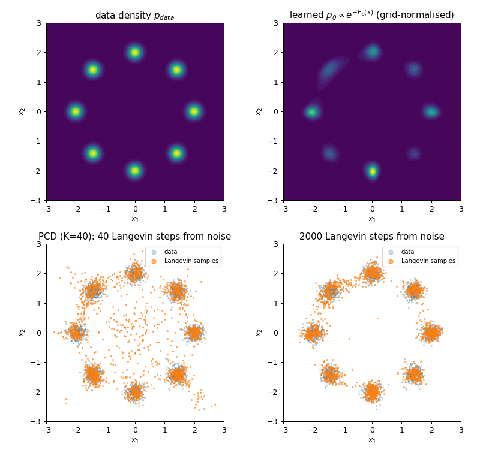
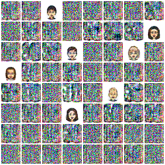

# Energy-Based Models

Tutorial code for energy-based models (EBMs): $p_\theta(x) = e^{-E_\theta(x)} / Z_\theta$ with a neural network energy $E_\theta$, trained by maximum likelihood with Langevin samples. Each version adds one idea: short-run Langevin on a 2-D toy (version0), persistent chains in a replay buffer (version1), an image EBM on Bitmoji faces that also inpaints and denoises (version2), and conditional super-resolution $E_\theta(x_{hr}\mid x_{lr})$ (version3).

---

## Theory

Please note that the theory corresponding to the codes is hosted on this [page](https://parag1604.github.io/notes/Machine-Learning/Energy-Based-Models). The notation below follows it: energy $E_\theta$, temperature $\tau$, Langevin step size $\eta$, and the score $\nabla_x \log p_\theta(x) = -\nabla_x E_\theta(x)$.

## Python Environment Setup

Use python >= 3.10 and install the requirements:

```bash
pip install -r requirements.txt
```

- PyTorch: models, automatic differentiation and training (install the hardware-accelerated build if possible; the image scripts pick CUDA, then Apple MPS, then CPU)
- Torchvision: saving image grids
- NumPy and Pillow: loading and caching the images
- Matplotlib: the toy plots

## Data

`version0.py` and `version1.py --data toy` need no data: they sample a mixture of 8 Gaussians on a circle on the fly.

The image versions use **Bitmoji faces**: 130,227 cartoon avatar heads, 128x128 RGB PNGs on a white background (about 1.4 GB). The copy used here was downloaded from the internet; we could not pin down the exact original page, so get it from a public Bitmoji dataset (e.g. Kaggle). The scripts expect a **flat folder of image files**:

```
data/bitmojis/
    199700001-10212369-0.png
    199700002-10212369-0.png
    ...
```

(File names in our copy have the form `<number>-10212369-0.png`; any names work.) On first use the scripts read the folder once, resize to the working resolution and cache the result as `data/bitmojis_<size>.npy` (0.4 GB at 32x32, 1.6 GB at 64x64). The last 2,000 files in name order are held out as a test set. Neither the data nor the cache is committed to this repository.

## The common pieces

Every script uses the same three ingredients (`utils.py`).

**The likelihood gradient** (lecture eq. 9). $Z_\theta$ is intractable, but its gradient is an expectation under the model, so

$$\nabla_\theta\,\mathrm{NLL} = \mathbb{E}_{x\sim p_{data}}[\nabla_\theta E_\theta(x)] - \mathbb{E}_{x'\sim p_\theta}[\nabla_\theta E_\theta(x')].$$

Energy goes down on data and up on the model's own samples. With $x'$ drawn by a few MCMC steps and treated as constants, this is the contrastive-divergence idea (Hinton 2002). The loss we minimise is

$$L = \overline{E_\theta(x)} - \overline{E_\theta(x')} + \alpha\,\overline{E_\theta(x)^2 + E_\theta(x')^2},$$

where the bars are batch means and the $\alpha$ term keeps the energies near zero (Du & Mordatch 2019).

**Langevin dynamics** (lecture eq. 10), at temperature $\tau$:

$$x_{k+1} = x_k - \tfrac{\eta}{2}\nabla_x E_\theta(x_k) + \sqrt{\eta\tau}\,\epsilon_k,\qquad \epsilon_k\sim\mathcal N(0, I).$$

It needs only the score, so $Z_\theta$ never appears (Welling & Teh 2011 use the same update for Bayesian posteriors). The code writes it as `x - step_size * grad + noise_std * eps`, i.e. `step_size` $=\eta/2$ and `noise_std` $=\sqrt{\eta\tau}$. The toys use the exact sampler, $\tau = 1$. The image models follow common practice and use far less noise than that (e.g. `step_size = 10`, `noise_std = 0.005` in version2, which is $\tau\approx 10^{-6}$), and clip each gradient entry: their chains are noisy optimisers rather than exact samplers.

**Short-run vs persistent chains.** Short-run chains start from noise at every iteration (Nijkamp et al. 2019); persistent chains continue where earlier chains stopped, from a replay buffer (Tieleman 2008; Du & Mordatch 2019).

## Running

### 0. Short-run Langevin on a 2-D toy

```bash
python version0.py
```

The energy $E_\theta:\mathbb{R}^2\to\mathbb{R}$ is a small MLP with SiLU (Swish) activations, which keep the landscape and its gradient smooth. The data are 8 Gaussians on a circle. Every iteration starts 256 fresh chains from uniform noise, runs $K=100$ exact Langevin steps ($\eta=0.005$, $\tau=1$), and takes one Adam step on $L$ with $\alpha=0.01$. After 3,000 iterations (2.5 to 3.5 min on an Apple-silicon CPU) the script draws 2,000 new chains and writes `results/version0_toy.png`:


| | samples within 0.5 of a mode | share of the smallest / largest mode (ideal 0.125) |
|---|---|---|
| short-run samples, $K=100$ (as in training) | 97.9% | 0.111 / 0.139 |
| long-run samples, 2,000 steps | 98.4% | 0.068 / 0.180 |
| the learned density $e^{-E_\theta}$ itself (normalised on the plotting grid) | | 0.003 / 0.286 (total variation from uniform: 0.39) |

The lesson of Nijkamp et al. (2019): a model trained with short-run chains from noise becomes an excellent **$K$-step sampler**, but $e^{-E_\theta}$ is **not** a faithful density. Its wells have very different depths, and chains run for longer than $K$ steps drift toward the deep ones.

### 1. Persistent chains: a replay buffer

```bash
python version1.py --data toy
python version1.py --data bitmoji --data-dir /path/to/bitmojis --iters 4000
```

The one new idea is the **replay buffer** (persistent contrastive divergence; Tieleman 2008, Du & Mordatch 2019). The buffer holds 10,000 chain states. Each iteration takes a batch from it, restarts 5% of them from noise, runs $K$ Langevin steps and writes the results back. A chain that is picked many times has run for hundreds or thousands of steps, so the negatives approach samples of $p_\theta$ itself, not of a $K$-step sampler. Two stabilisers come with it: parameter-gradient norm clipping (max norm 1) and a cosine learning-rate decay on the toy; `--spectral-norm` adds spectral normalisation (off by default).

**Toy** ($K=40$, 3,000 iterations, about 1 min on a CPU; `results/version1_toy.png`):



| | samples within 0.5 of a mode | smallest / largest mode share |
|---|---|---|
| 40 steps from noise | 82.5% | 0.095 / 0.153 |
| 2,000 steps from noise | 94.6% | 0.105 / 0.162 |
| learned density $e^{-E_\theta}$ | | 0.042 / 0.192 (total variation from uniform: 0.17) |

Now the trade-off is reversed: the energy is a better density (total variation 0.17 against 0.39 for version0; one seed each), and long chains sample it well, but it is a worse 40-step sampler from noise, because it was never trained to be one. There is also a faint spurious ridge between two modes in the top-right panel.

**Images** (32x32 Bitmojis, a small ConvNet energy of width 32, $K=60$, `step_size` 10, gradient entries clipped to $\pm0.03$, `noise_std` 0.005, $\alpha=0.1$, batch 128, Adam lr $10^{-4}$, 4,000 iterations: 77 min on an NVIDIA GB10 that was shared with other jobs):


Honest result: this small model only half works. About a quarter of the buffer has become recognisable faces (the long-lived chains), but most buffer states and all fresh 240-step chains from noise (second grid) are still coloured noise. version2 uses a wider network and fixes the sampler.

### 2. An image EBM on Bitmojis, and using its energy

```bash
python version2.py --data-dir /path/to/bitmojis          # trains, saves checkpoints/version2_iter<N>.pt every 1,000 iterations
python version2.py --data-dir /path/to/bitmojis --eval-only --checkpoint checkpoints/version2_iter3000.pt
```

New compared to version1: a full image model, and a second use of the energy. The energy is a ConvNet with SiLU activations and no normalisation layers (width 64, three stride-2 stages, global average pooling; 2.5 M parameters) on 32x32 faces scaled to $[-1, 1]$. Training uses the replay buffer of version1 (10,000 states, 5% restarts), $K=60$ Langevin steps with `step_size` 10, gradient entries clipped to $\pm0.01$, `noise_std` 0.005, $\alpha=0.1$, batch 128, Adam with lr $5\times10^{-5}$ and $\beta_1=0$, and bfloat16 autocast (twice as fast).

An energy is a prior that can be reused **without retraining**:
- **inpainting:** keep the observed pixels fixed and run Langevin on the missing ones only (starting from the average training image);
- **denoising:** start from the noisy image and run 20 noise-free steps downhill on $E_\theta$.

**Watch for collapse.** Image EBMs are finicky. Our first run, with the sampler of version1 (gradient clip $\pm0.03$, lr $10^{-4}$), looked good after 1,250 iterations and then collapsed: by 4,441 iterations (50 min) almost the whole buffer was saturated coloured noise, which the energy had come to treat as likely:



The script therefore logs a collapse detector, the ratio of pixel-to-pixel variation in the buffer to that in real images (1 = healthy), and saves a checkpoint every 1,000 iterations. With the gentler sampler and learning rate above, the ratio stayed at 1.1 to 1.2 up to iteration 2,750, rose to 1.35 at 3,000 and to 2.3 at 3,750 (38 min), when we stopped the run. All results below use the **iteration-3,000 checkpoint** (34 min of training on the shared GB10). A spectral-normalised variant (`--spectral-norm`, same settings) drifted earlier (ratio 2.1 at iteration 2,500) and was stopped.

Replay-buffer samples (the persistent chains):


Most are recognisable Bitmoji faces with varied hair, skin and backgrounds; some are noisy or blotchy. Fresh chains from noise are much worse: after 400 steps they have only begun to form a face-like blob (columns: noise, then 10, 20, 40, 60, 100, 200 and 400 steps):


So, as in the toy, the buffer model is a better density than a sampler from scratch: good samples need the long effective chains of the buffer.

Restoration on the 2,000 held-out faces (PSNR on the whole image):

| task | baseline | EBM |
|---|---|---|
| denoising, Gaussian noise $\sigma=0.2$ | noisy input 21.85 dB | **23.93 dB** |
| inpainting, lower half missing | average-face fill 18.67 dB | 18.43 dB |

")

")

Denoising works: 20 descent steps on the energy remove most of the noise (+2.1 dB). Inpainting produces plausible chins, mouths and shirts, but they are the model's own guess, so the PSNR is slightly below the blurry average-face fill (PSNR rewards averages, not plausible guesses; see version3).

### 3. Conditional super-resolution, $E_\theta(x_{hr}\mid x_{lr})$

```bash
python version3.py --data-dir /path/to/bitmojis                    # conditional (default)
python version3.py --data-dir /path/to/bitmojis --unconditional    # Parag's original formulation
```

**Credit.** The idea and the first implementation are Parag's (the original course code, `main_SR.py`): super-resolve a face by running Langevin descent on an energy, starting from the blurry upsampled image. In that code the energy scored the high-resolution image alone, $E_\theta(x_{hr})$, so the low-resolution input only chose where the chain started.

**What version3 adds.** The energy is now **conditional**,

$$p_\theta(x_{hr}\mid x_{lr}) = \frac{e^{-E_\theta(x_{hr},\,x_{lr})}}{Z_\theta(x_{lr})},$$

with the bicubic-upsampled $U(x_{lr})$ stacked with $x_{hr}$ as a 6-channel input. Training is eq. 9 with every expectation conditioned on $x_{lr}$; the negatives come from $K=20$ short-run Langevin steps started at $U(x_{lr})$, and at test time the same chain is the super-resolver. Because the degradation $D$ (antialiased bicubic downsampling) is known, it also gives a likelihood, so we can add a data-consistency energy at test time (posterior = likelihood x prior):

$$E_{total}(x) = E_\theta(x\mid x_{lr}) + \tfrac{\lambda}{2}\lVert D(x) - x_{lr}\rVert^2,\qquad \lambda = 50.$$

**Setup.** 64x64 faces from 16x16 inputs (4x), ConvNet width 64, batch 64, Adam lr $10^{-4}$, `step_size` 5 with gradient entries clipped to $\pm0.01$, `noise_std` 0.005, $\alpha=0.1$. Each model trained for 40 to 50 min (about 4,800 iterations) on the shared GB10. Evaluation on the 2,000 held-out faces; PSNR is on the $[-1,1]$ scale, "consistency" is PSNR($D(\hat x)$, $x_{lr}$), and "sharpness" is the mean absolute difference between neighbouring pixels.

| method | PSNR vs ground truth | consistency | sharpness |
|---|---|---|---|
| bicubic | 18.79 dB | 30.93 dB | 0.047 |
| consistency term alone, no EBM (gradient descent on $\tfrac{\lambda}{2}\lVert D(x)-x_{lr}\rVert^2$) | 19.89 dB | 40.60 dB | 0.063 |
| **conditional EBM** chain | 18.63 dB | 29.57 dB | 0.060 |
| conditional EBM, no Langevin noise | 18.67 dB | 29.79 dB | 0.054 |
| conditional EBM + consistency | 19.89 dB | 40.79 dB | 0.064 |
| unconditional EBM (the original formulation), same training | 18.48 dB | 29.22 dB | 0.063 |
| unconditional EBM + consistency | 19.86 dB | 40.81 dB | 0.066 |
| ground truth | | exact | 0.094 |


*Rows: bicubic | conditional EBM | EBM + consistency | ground truth.* The unconditional model's grid is in `static/version3_uncond_sr.png`.

Honest summary:
- The chain runs and is stable, and it **sharpens** the bicubic image (sharpness 0.047 to 0.060), but it does **not** beat bicubic in PSNR (-0.16 dB). This is the usual perception-distortion trade-off (Blau & Michaeli 2018): a 4x input from 16x16 pixels leaves many plausible faces, and a sharp guess is penalised by PSNR more than a blurry average.
- Conditioning on $x_{lr}$ helps a little over the original unconditional energy (18.63 against 18.48 dB, 29.57 against 29.22 dB consistency).
- The large gain (+1.1 dB PSNR, +10 dB consistency) comes from the known degradation $D$ (the consistency term), and almost all of it is obtained **without** the EBM. With it, the EBM adds +0.2 dB of consistency and slightly more sharpness, not more PSNR.
- We also tried training with the consistency term inside the chains (`--train-lam 50 --lr 3e-5`, 55 min). Its EBM + consistency result was the same (19.88 dB), and its energy alone was poor (16.75 dB), since it never had to work without the likelihood.


## References

1. G. E. Hinton (2002). *Training Products of Experts by Minimizing Contrastive Divergence*. Neural Computation 14(8), 1771-1800. [doi:10.1162/089976602760128018](https://doi.org/10.1162/089976602760128018)
2. T. Tieleman (2008). *Training Restricted Boltzmann Machines using Approximations to the Likelihood Gradient*. ICML 2008. [doi:10.1145/1390156.1390290](https://doi.org/10.1145/1390156.1390290)
3. M. Welling and Y. W. Teh (2011). *Bayesian Learning via Stochastic Gradient Langevin Dynamics*. ICML 2011. [pdf](https://www.stats.ox.ac.uk/~teh/research/compstats/WelTeh2011a.pdf)
4. Y. Du and I. Mordatch (2019). *Implicit Generation and Modeling with Energy-Based Models*. NeurIPS 2019. [arXiv:1903.08689](https://arxiv.org/abs/1903.08689)
5. E. Nijkamp, M. Hill, S.-C. Zhu and Y. N. Wu (2019). *Learning Non-Convergent Non-Persistent Short-Run MCMC Toward Energy-Based Model*. NeurIPS 2019. [arXiv:1904.09770](https://arxiv.org/abs/1904.09770)
6. Y. Blau and T. Michaeli (2018). *The Perception-Distortion Tradeoff*. CVPR 2018. [arXiv:1711.06077](https://arxiv.org/abs/1711.06077)
7. P. Lippe. *Tutorial 8: Deep Energy-Based Generative Models*, UvA Deep Learning Tutorials (the image sampler settings follow it). [link](https://uvadlc-notebooks.readthedocs.io/en/latest/tutorial_notebooks/tutorial8/Deep_Energy_Models.html)
